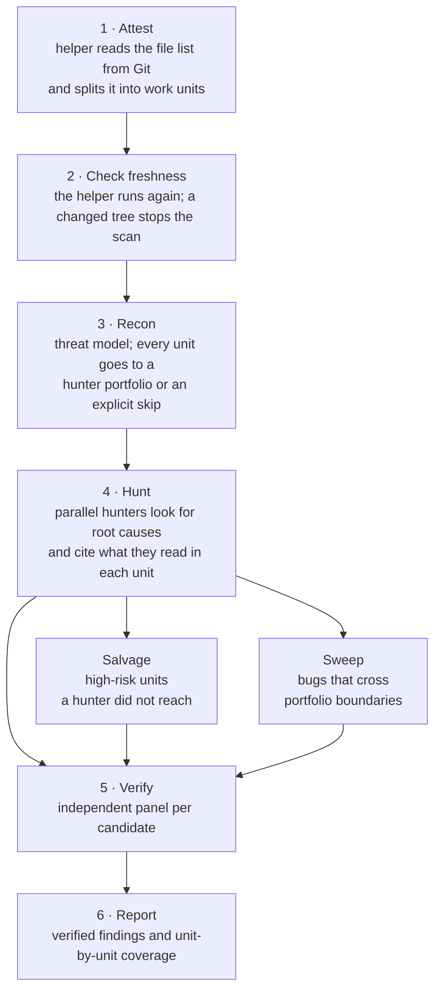
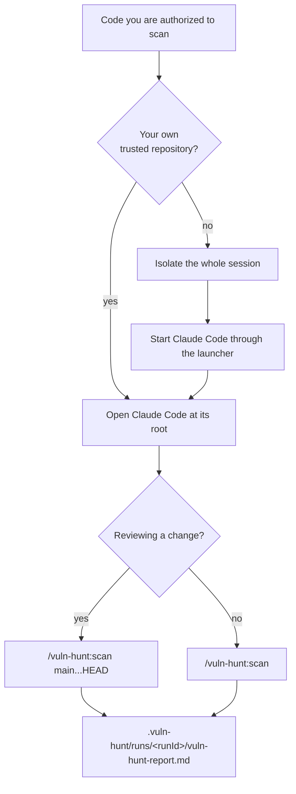
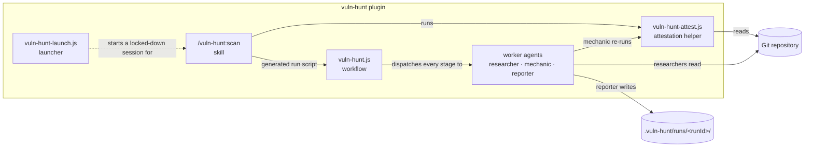
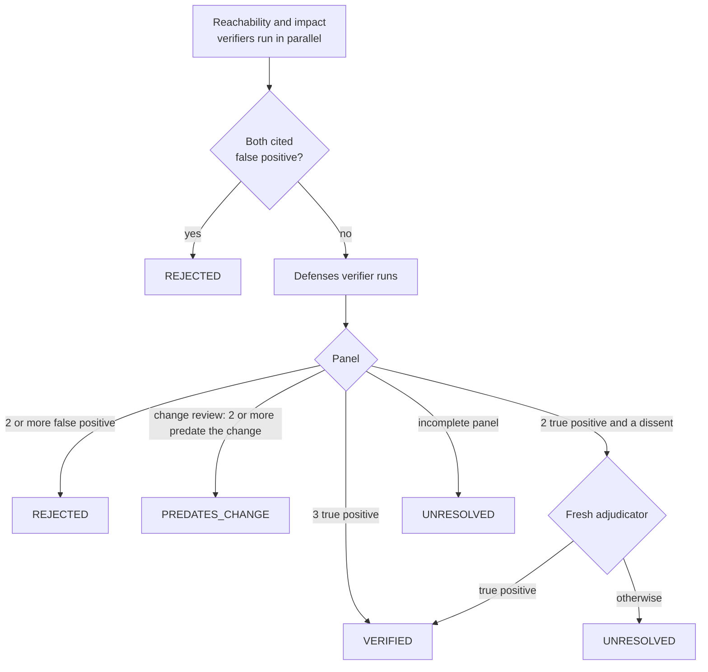

<p align="center"></p>

# vuln-hunt

vuln-hunt is a Claude Code plugin that hunts for security vulnerabilities in source code you are authorized to
test. It splits a Git repository into fixed pieces of work, sends read-only research agents through every piece,
and reports only the findings that independent verifiers confirm with citations, together with a record of what
was and was not covered.

```text
/plugin marketplace add developingchet/vuln-hunt
/plugin install vuln-hunt@vuln-hunt
```

Then open Claude Code at the root of the repository and run `/vuln-hunt:scan`.

**Use it only on code you are authorized to test.**

## Why it exists

Asking a model to "find the vulnerabilities in this repository" gives an answer that is hard to trust in two
ways. You cannot tell what it looked at, so a short list of findings could mean a clean codebase or a model that
read three files. And a single model's finding is a hypothesis, not a result: it may be unreachable, already
defended, or not a vulnerability at all.

vuln-hunt answers both:

- **Scope is computed, not claimed.** A helper script reads the exact file list from Git, outside any model, and
  splits it into work units. Every unit must be assigned, and every unit's outcome is reported. A unit counts as
  reviewed only when the researcher cites lines inside it, enough of them for its size, and the citations are
  mechanically checked against the real files and line counts.
- **Findings are verified independently.** Each candidate goes to separate verifiers that check reachability,
  impact and existing defenses on their own, each with citations. Only a candidate the panel confirms is
  reported as a finding.
- **Repository text cannot steer the scan.** Research agents can only read and search files. They cannot run
  commands, write files, reach the network or call MCP tools, whatever a file in the repository tells them.

It carries no fixed vulnerability checklist. The researchers derive hypotheses from the target's own code: its
trust boundaries, state, ownership, dangerous operations and invariants.

## How it works



1. **Attest.** `vuln-hunt-attest.js` reads the tracked and untracked files from Git, hashes their bytes, and
   splits them into at most 24 work units in a fixed, repeatable order. The result is the attestation: a JSON
   record of exactly what the scan covers. With a range such as `main...HEAD`, it also records the change.
   `--emit-run` writes the attestation, plus a generated workflow script with the attestation embedded verbatim,
   into a private directory outside the repository, so it reaches the workflow by file path instead of through
   the session's model.
2. **Check freshness.** Before any research starts, the helper runs again and its fingerprint must match the
   attestation. A tree edited, pulled or switched since step 1 stops the scan. After the report, the check runs
   once more, and a tree that changed during the scan is flagged in the result.
3. **Recon.** A researcher builds a threat model of the repository and assigns every unit to a hunter portfolio
   or skips it with a reason.
4. **Hunt.** Up to six hunters work in parallel, each on its portfolio, and return candidate root causes with
   `file:line` citations and a coverage receipt for each unit. A salvage pass revisits high-risk units a hunter
   did not reach, and a sweep looks for bugs that cross portfolio boundaries.
5. **Verify.** Each candidate goes to verifiers that judge reachability, impact and defenses independently. Two
   cited false-positive votes reject it early; three true-positive votes verify it; a full panel with two
   true-positive votes goes to a fresh adjudicator. A vote that never returns is retried once, and a panel that
   still cannot complete is recorded as unresolved by infrastructure, never as a clean verdict. Every citation
   the researchers and verifiers produced is then checked mechanically against the real manifest and the real
   line counts, and a citation that fails cannot support a verdict or a coverage receipt.
6. **Report.** The reporter writes the verified findings and the coverage table to `.vuln-hunt/runs/<runId>/`,
   and the written files are mechanically validated against the run's ledger before the result is returned.

## Installation

### Requirements

- Claude Code 2.1.305 or later with dynamic workflows turned on: the **Dynamic workflows** row in `/config`
  ([Workflows](https://code.claude.com/docs/en/workflows)). The plugin is tested with 2.1.325.
- Git, and a Git checkout of the code to scan.
- Node.js on `PATH`, installed outside the repository being scanned.
- A strong model chosen with `/model`; the research and verification stages use it.

### Install

In Claude Code:

```text
/plugin marketplace add developingchet/vuln-hunt
/plugin install vuln-hunt@vuln-hunt
```

Or from a shell:

```bash
claude plugin marketplace add developingchet/vuln-hunt
claude plugin install vuln-hunt@vuln-hunt
```

`/plugin install vuln-hunt --marketplace developingchet/vuln-hunt` does both steps in one command in Claude
Code 2.1.275 or later; from a shell, `claude plugin install vuln-hunt --marketplace developingchet/vuln-hunt`
needs 2.1.292 or later. After a shell install, run `/reload-plugins` in a session that was already open. See
[Tell users how to install](https://code.claude.com/docs/en/plugins/publish#tell-users-how-to-install) and
[Install and manage plugins](https://code.claude.com/docs/en/plugins/install#add-a-marketplace-and-install-in-one-command).

The install follows the default branch, and `claude plugin update` brings a new copy once a release raises
`version` in `plugin.json`. Auto-update is off for this marketplace by default; to receive releases without running
`claude plugin update`, open `/plugin`, then **Marketplaces**, select `vuln-hunt`, then **Enable auto-update**
([Keep plugins updated](https://code.claude.com/docs/en/plugins/install#keep-plugins-updated)). To stay on one
release instead, see [Install a release](#install-a-release).

### Install a release

A marketplace added with `#<tag>` installs the tree of that release. Each
[release](https://github.com/developingchet/vuln-hunt/releases) is tagged `vuln-hunt--v<version>` and its notes
give the exact commands:

```text
/plugin marketplace add developingchet/vuln-hunt#vuln-hunt--v<version>
/plugin install vuln-hunt@vuln-hunt
```

The marketplace's source, including the tag, is recorded in your settings, and adding it again from another
source is refused. To pin an install made from the default branch, or to move a pinned install to a later
release, remove the marketplace first, which also uninstalls the plugin, then run the two commands above:

```text
/plugin marketplace remove vuln-hunt
```

Release tags are protected from moving, so `claude plugin update` finds nothing new for a pinned install. See
[Marketplace sources](https://code.claude.com/docs/en/plugins/marketplace-reference#marketplace-sources) and the
[plugin CLI reference](https://code.claude.com/docs/en/plugins/cli-reference).

To check an installed copy against a release, verify the release zip with the commands in its notes, unpack
it, and compare it with the installed copy:

```bash
diff -r --exclude=.in_use <unpacked zip> ~/.claude/plugins/cache/vuln-hunt/vuln-hunt/<version>/
```

No output means the installed files are exactly the signed release. `.in_use` is created by Claude Code and is
not part of the release.

### Update and remove

```bash
claude plugin marketplace update vuln-hunt
claude plugin update vuln-hunt@vuln-hunt
claude plugin uninstall vuln-hunt@vuln-hunt
```

`claude plugin update` installs a new copy only when `version` in `plugin.json` has changed; a pinned install
moves only as [Install a release](#install-a-release) describes. Each command is described in the
[plugin CLI reference](https://code.claude.com/docs/en/plugins/cli-reference).

### What gets installed

| Name | What it is |
|---|---|
| `/vuln-hunt:scan` | Skill: attests the repository and runs the workflow with strict provenance. |
| `/vuln-hunt:options` | Skill: lists every workflow option with its values and default, the presets, and the argument forms `/vuln-hunt:scan` accepts. |
| `/vuln-hunt:helpers` | Skill: prints the launcher, attestation and postflight commands with this installation's paths. |
| `/vuln-hunt:vuln-hunt` | The workflow, for running it with your own options. |
| `vuln-hunt:vuln-hunt-researcher` | Worker agent for recon, hunting and verification: Read, Glob and Grep only. |
| `vuln-hunt:vuln-hunt-mechanic` | Worker agent that runs the helper for the freshness check. |
| `vuln-hunt:vuln-hunt-reporter` | Worker agent that writes the report files. |

Names carry the plugin's prefix, as
[plugin workflows](https://code.claude.com/docs/en/workflows#distribute-a-workflow-in-a-plugin) and
[plugin agents](https://code.claude.com/docs/en/plugins/components#agents) do. The scripts live in the plugin's
installed folder, `~/.claude/plugins/cache/vuln-hunt/vuln-hunt/<version>/`
([plugins on disk](https://code.claude.com/docs/en/plugins/loading#find-plugins-on-disk)); `/vuln-hunt:helpers`
prints the exact paths.

## Usage

### Scan a repository

Open Claude Code at the repository's root and run:

```text
/vuln-hunt:scan
```

The skill runs the attestation helper with `--emit-run`, which writes a private run directory outside the
repository holding the attestation and a generated workflow script with the attestation embedded byte-for-byte,
then starts the workflow from that script's path with `strictProvenance`. The attestation never passes through
the session's model, so a large or array-heavy attestation cannot be reordered or mangled in transit. Claude Code
shows the workflow's plan for approval before it runs
([approve the plan](https://code.claude.com/docs/en/workflows#approve-the-plan-before-it-runs)). When it
finishes, read `.vuln-hunt/runs/<runId>/vuln-hunt-report.md`.

Strict provenance needs a clean checkout: commit or stash changes first. The skill runs the first `node` on
`PATH`; the helper then refuses to continue if that Node, or the helper itself, lives inside the repository being
scanned. The generated run script stays on disk until you delete it, so an interrupted run can be resumed:
call the Workflow tool again with the same `scriptPath` and the interrupted run's `resumeFromRunId`; the script
path alone starts a fresh run.

### Review a change

```text
/vuln-hunt:scan main...HEAD
```

The checkout must be clean and at the range's head. Researchers see the changed hunks and removed lines from the
attestation, and read added lines from the checkout. The change evidence (up to 256 files, 16 KiB of removed
lines per file, 256 KiB overall) is embedded in the generated run script, so its size costs no conversation
context; for very large changes, review smaller ranges to keep the workflow's own argument handling small.

| Range | Reviewed change |
|---|---|
| `A..B` | tree A to tree B |
| `A...B` | merge base of A and B to B |
| `REF` | REF's first parent to REF; the empty tree to a root commit |

### Set options

Run `/vuln-hunt:scan` with no arguments to choose the scope, the depth and how many agents run at once from a
short set of questions. To set options directly, give a preset, `option=value` pairs or a JSON object, in any
order after an optional range; options given explicitly win over the preset:

```text
/vuln-hunt:scan deep
/vuln-hunt:scan main...HEAD quick maxConcurrentAgents=8
/vuln-hunt:scan hunters=5 variants no-sweep models.hunt=opus policyDocs=SECURITY.md
/vuln-hunt:scan {"hunters":5,"variants":true}
```

A true/false option can be named alone to turn it on, or with `no-` to turn it off, and one stage of `models`
or `efforts` is set as `models.<stage>=<model>`. The skill resolves the arguments with
`vuln-hunt-options.js`, which refuses unknown options and out-of-range values before anything runs, and shows the
resulting settings before the scan starts. A request written in plain words is rewritten into these forms and
shown for confirmation first. `/vuln-hunt:scan help` and `/vuln-hunt:options` list every option.

<!-- vuln-hunt-presets:start -->
| Preset | Sets | Use |
|---|---|---|
| `quick` | `hunters=2`, `candidateCap=2`, `salvage=false`, `sweep=false` | A fast first look: two hunters with fewer candidates each, and no salvage or cross-portfolio sweep. |
| `standard` | nothing | The workflow defaults. |
| `deep` | `hunters=6`, `candidateCap=5`, `salvageRisk=all`, `saturationContinuation=true`, `variants=true` | The most thorough and slowest: six hunters with more candidates each, salvage of every unreached unit, a continuation pass and variant analysis. |
<!-- vuln-hunt-presets:end -->

See [Options](#options) for the full list.

### Scan a repository you do not trust

Isolate the whole session (see [Isolation](#isolation)) and start Claude Code through the launcher, which shuts out
the repository's own settings, hooks, `CLAUDE.md` files and MCP servers:

1. Run `/vuln-hunt:helpers` once to get the launcher's path.
2. From the repository root, in a terminal: `node "<plugin folder>/vuln-hunt-launch.js"`.
3. In that session, run `/vuln-hunt:scan`.



### Run without prompts

In print mode (`claude -p`) the workflow's plan is not offered for approval, so allow the `Workflow` tool for the
run, and keep the session waiting for the scan: a headless session stops waiting for background work after ten
minutes unless `CLAUDE_CODE_PRINT_BG_WAIT_CEILING_MS` is `0`
([environment variables](https://code.claude.com/docs/en/env-vars#variables)). The launcher sets it for you.
`--max-budget-usd` ([CLI flags](https://code.claude.com/docs/en/cli-reference#cli-flags)) caps spending by ending
the session, and with it the scan.

## Architecture



| File | Role |
|---|---|
| `.claude-plugin/plugin.json`, `.claude-plugin/marketplace.json` | Plugin manifest and the marketplace that lists it. |
| `vuln-hunt.js` | The workflow: validates options and the attestation, runs every stage, enforces the verification rules and builds the result. |
| `vuln-hunt-attest.js` | Node helper with no dependencies: attestation, fingerprint for the freshness check, comparison for postflight, self-test. |
| `vuln-hunt-options.js` | The workflow's options, values and defaults, the presets, and the parser that turns `/vuln-hunt:scan`'s arguments into workflow args. |
| `agents/*.md`, `vuln-hunt-agents.json` | The three worker agents: as plugin agents, and as the JSON the launcher and manual installer use. |
| `skills/scan`, `skills/options`, `skills/helpers` | The three skills. |
| `vuln-hunt-launch.js` | Starts Claude Code with session-level workers, user settings only and no MCP servers. |
| `*.ps1` | Windows wrappers: manual installer, prerequisite check, attestation and postflight. |
| `tests/run.js` | Regression suite, run on Windows and Ubuntu in CI. |

The workflow is plain JavaScript run by Claude Code's workflow runtime. Every model call goes through a worker
agent with a fixed tool list and without `CLAUDE.md`
([`omitClaudeMd`](https://code.claude.com/docs/en/sub-agents#supported-frontmatter-fields)); the workflow itself
checks schemas, citations, votes and hashes in code, so a model cannot talk its way past them.

## Security model

### Worker agents

| Worker | Tools | Stages |
|---|---|---|
| `vuln-hunt-researcher` | Read, Glob, Grep | recon, hunters, continuation, salvage, sweep, verifiers, adjudicator, variants |
| `vuln-hunt-mechanic` | Bash, PowerShell, Read, Glob, Grep | freshness check, fallback inventory |
| `vuln-hunt-reporter` | Read, Glob, Write, Bash, PowerShell | report |

Dynamic reproduction (`mode: "dynamic"`) uses the default agent because it must run code.

The workflow uses the plugin's workers (`vuln-hunt:vuln-hunt-researcher` and so on) when they are installed, and
otherwise the bare names that the [manual install](#manual-install) and the launcher define. If neither exists
it stops with an error naming the worker, and never falls back to the default agent. The result records which
names it used.

A scanned repository's `.claude/agents/` files cannot replace a plugin worker: a project agent whose `name`
carries the plugin prefix does not register, as of Claude Code 2.1.325. A repository's project settings could
still enable a different plugin that is also named `vuln-hunt`, once you trust the folder; for a repository you
did not write, start through the [launcher](#the-launcher), which leaves project settings out. Bare names are
weaker, because a project agent outranks a user agent of the same name
([subagent scope](https://code.claude.com/docs/en/sub-agents#choose-the-subagent-scope)). The attestation helper
therefore refuses to run while any `.claude/agents/` directory from the working directory upward, other than
`~/.claude/agents/`, holds an agent file named after a worker or whose frontmatter mentions a worker's name. It
follows linked directories and reads quoted, escaped and BOM-prefixed frontmatter, so formatting tricks do not
hide a shadow.

### The launcher

`vuln-hunt-launch.js` starts Claude Code with:

- the workers passed through `--agents`, which outrank project and user agents;
- `--setting-sources user`, which leaves out project settings, project hooks and project `CLAUDE.md` files;
- `--strict-mcp-config` with an empty MCP configuration, which leaves out every MCP server.

See [CLI flags](https://code.claude.com/docs/en/cli-reference#cli-flags). Plugins installed at user scope,
vuln-hunt among them, still load. It finds `claude` outside the enclosing repository roots and passes any other
arguments, such as `--model`, through. It does not use `--restricted`, which would also stop user-level workflows
from loading.

Without the launcher, a subdirectory `CLAUDE.md` still loads into a worker that reads files in that directory
([how CLAUDE.md files load](https://code.claude.com/docs/en/memory#how-claude-md-files-load)). Every prompt treats
repository text as untrusted evidence either way.

### Isolation

| Target or activity | Policy |
|---|---|
| Your own trusted repository, static scan | isolation optional; normal permission hygiene still applies |
| Unfamiliar or third-party repository, static scan | whole-session isolation strongly recommended |
| Dynamic reproduction, builds, tests, fuzzing, running the target | externally enforced whole-session, container or VM isolation required |

Claude Code's [sandbox](https://code.claude.com/docs/en/sandboxing#what-runs-outside-the-sandbox) covers shell
commands only: file tools, MCP servers and hooks run outside it, and on native Windows commands run unsandboxed.
The [sandbox runtime](https://code.claude.com/docs/en/sandbox-environments#sandbox-runtime) wraps the whole Claude
Code process and is a beta research preview. For hostile native code, a disposable VM is the conservative choice.
[ISOLATION.md](ISOLATION.md) has the full policy.

The workflow cannot create or detect an isolation boundary, so dynamic mode requires the operator to assert one:

```json
{ "mode": "dynamic", "containment": "vm", "network": false, "credentials": false }
```

`containment` is one of `sandbox-runtime`, `container`, `vm` or `cloud-session`.

## Reference

### Options

The workflow's options are one JSON object, passed as `args` to `/vuln-hunt:vuln-hunt`; `/vuln-hunt:scan`
builds it from its arguments (see [Set options](#set-options)). Unknown keys, wrong types and out-of-range numbers
are refused with an error; an option left out takes its default. `vuln-hunt-options.js` holds the table below,
and `node vuln-hunt-options.js --list` prints it.

<!-- vuln-hunt-options:start -->
| Option | Values | Default | Effect |
|---|---|---|---|
| `attestation` | helper output | none | The attestation; required by `strictProvenance` and `range`. `/vuln-hunt:scan` embeds it in a generated run script instead of passing it here. |
| `strictProvenance` | `true`, `false` | `false` | Refuse anything short of an attested, clean, fully hydrated checkout. `/vuln-hunt:scan` always sets it. |
| `range` | `A..B`, `A...B`, `REF` | none | Review a change instead of the whole tree. |
| `hunters` | 2–6, `"auto"` | 4 | Most hunter portfolios recon may create. |
| `candidateCap` | 1–6 | 3 | Most candidates per hunter; a hunter that hits it is listed in `candidateSaturation`. |
| `maxConcurrentAgents` | 1–256 | runtime's own limit | Ceiling on agents this one run dispatches at once, across every stage, panels and retries included. Admission is first-in-first-out, and a failed agent releases its slot. |
| `policyDocs` | 1–8 paths | none | Repository security-policy documents to read as untrusted evidence; each must have been attested with `--policy-doc`. An attested document left out here is listed in `policyDocsAttestedInactive`. |
| `salvage` | `true`, `false` | `true` | Revisit units a hunter did not reach, at or above `salvageRisk`. |
| `salvageRisk` | `"high"`, `"medium"`, `"all"` | `"high"` | Lowest unit risk salvage covers. |
| `sweep` | `true`, `false` | `true` | Look for bugs across portfolio boundaries; never upgrades unit coverage. |
| `adjudicate` | `true`, `false` | `true` | Send split panels to a fresh adjudicator. |
| `saturationContinuation` | `true`, `false` | `false` | Give hunters that hit `candidateCap` one more pass for other roots. |
| `variants` | `true`, `false` | `false` | List other affected sites of verified roots. |
| `mode` | `"static"`, `"dynamic"` | `"static"` | `"dynamic"` adds contained reproduction. |
| `containment` | `"sandbox-runtime"`, `"container"`, `"vm"`, `"cloud-session"` | none | The externally enforced containment of the whole session, which dynamic mode requires; see [Isolation](#isolation). |
| `network` | `true`, `false` | none | Whether the session can reach the network; dynamic mode requires `false`. |
| `credentials` | `true`, `false` | none | Whether the session holds credentials; dynamic mode requires `false`. |
| `reproEnvironment` | object, see [Reproduction environment](#reproduction-environment) | none | A typed descriptor of the pre-built execution environment, so dynamic scans need no hand-edited workflow script. Its fields are checked by the workflow. |
| `reproMinSeverity` | `"critical"`, `"high"`, `"medium"`, `"low"` | none | Reproduce only verified findings at or above this severity, by the verifiers' own severity opinions. |
| `models` | per-stage map | see below | Model per stage. |
| `efforts` | per-stage map | see below | Effort per stage. |
| `allowSparse` | `true`, `false` | `false` | Accept a sparse checkout in a scan that is not strict. Not accepted by `/vuln-hunt:scan`, whose scans are always strict and attested. |
| `allowLfsPointers` | `true`, `false` | `false` | Accept LFS pointers in a scan that is not strict. Not accepted by `/vuln-hunt:scan`, whose scans are always strict and attested. |
| `runId` | string, not ending in a dot, not a Windows device name | derived | Run folder name when there is no attestation; an attestation's own `runId` always wins. Not accepted by `/vuln-hunt:scan`, whose scans are always strict and attested. |
| `tag` | string | none | A free-form label copied into the result. |
<!-- vuln-hunt-options:end -->

Research and verification stages inherit your `/model`. The report and the fallback inventory default to Sonnet,
and the freshness check to Sonnet at `low` effort. Override per stage:

```json
{
  "models": { "hunt": "inherit", "verify": "inherit", "report": "sonnet" },
  "efforts": { "recon": "high", "hunt": "xhigh", "verify": "xhigh", "report": "medium" }
}
```

Stages are `recon`, `hunt`, `continuation`, `salvage`, `sweep`, `verify` (or one panel seat:
`verifyReachability`, `verifyImpact`, `verifyDefenses`), `adjudicate`, `variants`, `repro`, `validate` (the
mechanical citation, report and prior-run checks), `report`, `inventory`
and `freshness`, plus `default`. The result records the requested routing; Claude Code's workflow
details show the model actually served.

### Running the workflow directly

`/vuln-hunt:scan` covers the usual case. To control each step, generate a run from the repository root for every
scan:

```bash
node "<plugin folder>/vuln-hunt-attest.js" --emit-run                  # whole tree
node "<plugin folder>/vuln-hunt-attest.js" --emit-run --range main...HEAD
node "<plugin folder>/vuln-hunt-attest.js" --emit-run --policy-doc SECURITY.md
```

The helper prints one line of JSON naming the private run directory. Run the `vuln-hunt:vuln-hunt` workflow with
the `scriptPath` it names and `args` such as `{"strictProvenance": true, "hunters": 4}`; the attestation is
already embedded in that script as the attestation file's exact JSON text. The generated script refuses an
`args.attestation` that differs from its embedded copy, `null` included. The helper also prints the script's
`scriptHash`; the workflow cannot hash its own source, so keep the run directory private and compare the hash
by hand if the directory could have been touched. Passing the attestation as `args.attestation` to the plain
template still works for small attestations: the workflow recomputes its state hash and refuses any copy that
differs from the helper's output.

Without an attestation, a whole-tree scan that is not strict still runs: a Sonnet inventory agent lists and
partitions the files, and provenance is labeled `MODEL_REPORTED_PROVENANCE`. That mode is weaker and should not be
relied on for coverage claims; mechanical citation validation is unavailable without an attestation and is
reported as such.

### The attestation

The helper derives everything from Git, outside any model. The file list honors the repository's `.gitignore`
files but not `core.excludesFile` or `.git/info/exclude`, so local ignore settings cannot hide source. Untracked OS,
editor and Claude Code metadata is left out: `.DS_Store`, `Thumbs.db`, `ehthumbs.db` and `desktop.ini` anywhere,
and the top-level `.idea/`, `.vscode/` and `.claude/settings.local.json`.

It records:

- the canonical repository root, the revision and the exact file list, with its hash and count
- the work units, a hash of each unit's members and `unitsHash` over all of them
- `contentHash`, a SHA-256 over the working-tree bytes of every listed file, read directly rather than through Git
  filters
- tracked symlinks, submodules and deleted files; index entries marked assume-unchanged or skip-worktree make
  the tree DIRTY
- sparse, shallow and partial-clone state, Git filters, grafts and object alternates
- case collisions, LFS pointers and the safety of the output path
- each policy document named with `--policy-doc`, hashed over its bytes and bound into `stateHash`
- for a change review: the endpoints, the changed files and, per file, its status, modes, rename source, hunk
  coordinates and removed lines (up to 256 files, 16 KiB per file and 256 KiB overall)
- `stateHash` over all of it, and the `helperPath` and `nodePath` the freshness check runs again

Units use bytewise UTF-8 order, so Windows and Linux split the same paths the same way.

The attestation is not signed; anyone can edit JSON. It is an independently computed record, meant to go
straight from the helper to the workflow, which recomputes `stateHash` and refuses any mismatch. Version 5 adds
`policyDocs`; the workflow refuses a version-4 attestation, so regenerate it after a plugin update.

### Freshness and postflight

Before recon, the mechanic worker runs the attested helper with the attested Node as `--fingerprint <runId>`,
repeating the attested `--policy-doc` list. The helper recomputes the attestation and prints its `stateHash`.
The workflow refuses the run unless the root, `HEAD`, worktree state, file list, content and state hashes all
match and `.vuln-hunt/runs/<runId>` does not exist yet. Before the report is written, the same fingerprint runs
once more; if the source state no longer matches, the result and the report carry `sourceChangedDuringRun: true`
prominently instead of silently presenting stale citations. Neither check can stop a concurrent writer during the run; use a
disposable clone or worktree for measured runs.

To confirm nothing changed during a run by hand, save the attestation outside the repository and compare
afterwards:

```bash
node "<plugin folder>/vuln-hunt-attest.js" > /tmp/vuln-hunt-before.json
# run the scan
node "<plugin folder>/vuln-hunt-attest.js" --compare /tmp/vuln-hunt-before.json
```

Pass the same `--range` and `--policy-doc` list to both for a change review. On Windows,
`Compare-VulnHuntPostflight.ps1 -BeforeFile <file>` does the same from PowerShell 5.1 or 7.3+, with `-Range` and
a repeatable `-PolicyDoc` for the same purpose.

### Policy documents

`policyDocs` names repository files — a `SECURITY.md`, a threat model, an authorization spec — whose claims the
researchers and verifiers check the code against:

```text
/vuln-hunt:scan {"policyDocs":["SECURITY.md"],"maxConcurrentAgents":3}
```

Each document must be attested: the scan skill passes it to the helper with `--policy-doc`, which requires it to
be in the manifest, refuses symlinks, and hashes its bytes into `stateHash`, so a document edited after
attestation stops the scan. Every research and verification prompt then carries the document with fixed
instructions: extract its explicit guarantees, trust boundaries and defaults; a claim the code contradicts is
evidence for a finding, cited against both the policy line and the source line; a vulnerability the documents
never mention is still valid and still reported; In-Scope/Out-of-Scope lists are disclosure-program metadata
only, so a technically valid out-of-scope finding stays in the report, labeled as outside the program's scope.
Severity follows the boundary a contradicted claim describes, not the mere fact of a documentation mismatch.

### Coverage states

| State | Meaning |
|---|---|
| `deep-reviewed` | its hunter reported it reached, cited lines inside it, and the receipts are enough for its size |
| `receipt-thin` | reached with citations, but fewer distinct ones than the unit needs (up to 8, scaled from one per 25 files); salvage revisits it when salvage is on and the unit's risk is at or above `salvageRisk` |
| `receipt-missing` | reported reached without a valid citation inside it, or all receipts failed mechanical validation |
| `not-reached` | its hunter reported it was not reached, with a reason |
| `coverage-conflict` | reported both reached and not reached |
| `unaccounted-by-hunter` | its hunter returned without mentioning it |
| `failed` | its hunter returned nothing |
| `gap-reviewed` | the salvage pass reached it and cited lines inside it, enough for its size |
| `skipped` | recon skipped it, with a reason |
| `unaccounted` | no stage recorded any state for it; a bug, not a coverage claim |

After the panels, every researcher and verifier citation is checked mechanically with
`--validate-citations`, and an adjudicator's citations are checked the same way before its vote counts: the
file must be in the live manifest (in any letter case on a case-insensitive checkout), a regular file reached
without a symlink or junction anywhere on its path, and the line must exist. Citations travel to the helper
base64-encoded, in batches of at most about 6 KB of JSON, so no file name text appears in the command the
mechanic runs and each command stays well inside the Windows command-line limit. The helper's output names
citations by index only and carries a hash of the input it received and a `resultHash` over the rest of the
output; the workflow recomputes both, which detects a garbled or truncated transport in either direction. Neither
is a signature, and a mechanic that rewrote the helper's output on purpose would not be detected by them.

Validation fails closed: a citation the helper rejected, and every citation it did not confirm (its batch did not
come back intact, it was past the cap of 4096 citations or 256 KiB, or it could not be parsed), is dropped from its
vote and its receipt.
Each batch stands alone, so one lost batch leaves the others' citations in place. A finding whose votes lost only
citations the helper rejected is `UNRESOLVED_EVIDENCE` when the panel can no longer decide; one where a vote lost
its verdict only because citations the helper never judged were dropped is `UNRESOLVED_INFRASTRUCTURE`, since the
gap is in the transport rather than in the evidence. The result's `coverage.citationsValidated` reports the outcome: `not-needed` (the scan produced no
citations), `validated`, `partial` (some citations could not be confirmed and were dropped),
`transport-failed` (none could be confirmed, so no finding verifies and reached units lose their receipts), or
`unavailable-no-attestation`; it merges every validation pass. Each `coverage.jsonl` row carries, as
`citationValidationStatus`, the status of the pass that validated receipts (researcher and panel citations), and
a boolean `citationsValidated` that is true only when that status is `validated` or `not-needed`. After `partial` or
`transport-failed`, rerun the scan before trusting its unresolved counts.

`deep-reviewed` and `gap-reviewed` remain the researcher's own accounting for which files were read; mechanical
validation confirms the citations point at real lines, not that every line was inspected.

### Verification rules

Each candidate gets a fixed `candidateId` plus a deterministic `findingId`, a SHA-256 over its file, symbol and
wording; the line is left out because unrelated edits move it. Both are per-run values: the same root cause can carry a different `candidateId` in another run, and an
unrelated vulnerability can reuse the same one. Never compare findings across runs by `candidateId` alone; see
[Cross-run reconciliation](#cross-run-reconciliation).

A true-positive vote needs complete source, path, sink, defense and gain reasoning and at least two valid
citations. False-positive and predates-the-change votes need cited refutation, and predates-the-change counts
only in a change review. Malformed votes count as unknown.

A candidate's final disposition is one of:

| Disposition | Meaning |
|---|---|
| `VERIFIED` | three true-positive votes, or two plus a fresh adjudicator's confirmation |
| `REJECTED` | two decisive false-positive votes, or a full panel with two or more |
| `PREDATES_CHANGE` | a change review where the flaw predates the reviewed change |
| `UNRESOLVED_EVIDENCE` | the panel completed but the evidence did not settle the question |
| `UNRESOLVED_INFRASTRUCTURE` | one or more votes, or the adjudicator's vote, never returned, even after a bounded recovery pass; or a vote lost its verdict because citation validation output was lost |
| `NOT_REACHED` | the candidate's panel task itself failed or returned nothing |

A vote that returns nothing is asked once more immediately and once more in a recovery pass that retries only the
missing seats; a failure the runtime reports as rate limiting gets one immediate retry, paced only by the
`maxConcurrentAgents` queue when it is set, so a seat is dispatched at most six times.
A panel that still cannot complete is `UNRESOLVED_INFRASTRUCTURE` with its missing seats named — never verified,
never rejected. Infrastructure failures never become verdicts.

### Cross-run reconciliation

Before the report, the helper's `--prior-findings` reads the `findings.jsonl` of the 16 most recent earlier runs
under `.vuln-hunt/runs/` (64 findings each, every field typed and bounded, with a `truncated` flag when anything
was left out), and each verified finding is related to them:

- `REPRODUCED_AGAIN`: the same `findingId` was verified in an earlier run.
- `TENTATIVE_MATCH`: the same file and symbol within 10 lines, but the mechanism was worded differently; confirm
  by hand before treating it as the same root cause.
- `NEW`: no match.
- `REASSESSED_NOT_VERIFIED`: a prior finding that matches a candidate this run examined but did not verify; the
  entry names that candidate and its disposition.
- `NOT_REASSESSED`: a prior finding with no counterpart among this run's candidates. Neither this nor the
  previous relation is treated as evidence of remediation; a failed reproduction is never treated as proof of a
  false positive.

The relations and counts appear in the workflow's result and in the report, with the prior run names.

### Reproduction environment

Dynamic mode without an environment descriptor leaves reproduction to the default agent inside the asserted
containment boundary. `reproEnvironment` replaces that with a typed descriptor of a pre-built environment, so
no workflow script needs hand editing:

```text
/vuln-hunt:scan {"mode":"dynamic","containment":"container","network":false,"credentials":false,"reproEnvironment":{"backend":"container","image":"registry.example/target@sha256:...","sourceLocation":"/repo","runtimeCapabilities":["python3.13"],"testEntrypoints":["pytest -q tests/"],"instructions":"dependencies are pre-installed; no network","timeoutMs":600000,"verifiedReady":true},"reproMinSeverity":"high","maxConcurrentAgents":3}
```

| Field | Values | Notes |
|---|---|---|
| `backend` | `"container"`, `"vm"` | Required. |
| `image` | immutable identifier | Required for a container: a digest or tag, 1–512 characters. |
| `sourceLocation`, `workingDirectory`, `artifactsDir` | location string | Where the source, the work and the artifacts live inside the environment. |
| `runtimeCapabilities` | up to 8 short names | Runtimes present, e.g. `python3.13`. A finding whose runtime is absent is reported as blocked, not silently skipped. |
| `testEntrypoints` | up to 8 commands | Existing test entrypoints to prefer over ad-hoc reproducers. |
| `instructions` | string, ≤ 4000 characters | Environment-specific notes; passed as untrusted data, never executed as instructions. |
| `resourceLimits` | `cpu`, `memory`, `pids` | Short strings the repro agent reads as descriptors. |
| `timeoutMs` | 1000–3600000 | Per-reproduction budget the repro agent is asked to keep; the workflow cannot enforce it. |
| `verifiedReady` | boolean | The operator's assertion that the environment exists and works; recorded, not trusted. |

A reproduction reports `REPRODUCED` only when the specific vulnerable execution path was reached with
attacker-controlled input and the security effect was observed, and a finding becomes `EXECUTION_REPRODUCED` only
when the result also sets `reachedVulnerablePath` and `attackerInputTested`. `reproMinSeverity` compares against
the highest severity any verifier gave; a finding no verifier rated is reproduced too. A generic test suite that merely passes is
environment readiness and is returned as `NOT_REPRODUCED`, never as a reproduction. Other statuses —
`BLOCKED_NO_REPRO_ENVIRONMENT`, `BLOCKED_MISSING_DEPENDENCY`, `BLOCKED_UNSUPPORTED_PLATFORM`, `TIMEOUT`,
`INFRASTRUCTURE_FAILED`, `NOT_ATTEMPTED` — keep per-finding evidence honest, and a failed reproduction never
refutes a statically verified finding by itself.

The workflow cannot verify a container's isolation itself. Keep the externally enforced boundary
(`containment`, `network:false`, `credentials:false`), prefer an image with the source baked in over host
mounts, and never mount credentials, sockets or home directories into it; see [Isolation](#isolation).



Citations are `{file, line, endLine?}`. Absolute, `./`-prefixed, backslash, Git Bash (`/d/...`) and WSL
(`/mnt/d/...`) forms of a path inside the repository are made repository-relative first, case-insensitively on a
case-insensitive checkout. A citation outside the file list does not count and is kept in `invalidCitations`.

Static evidence is the default; discovery and verification never build, test or run the target. Findings are
`STATICALLY_VERIFIED` or, with dynamic mode, `EXECUTION_REPRODUCED`.

### Git states that are refused

| State | Handling |
|---|---|
| partial or promisor clone | refused |
| object alternates | refused for strict scans and change reviews |
| sparse checkout | refused; a scan that is not strict may accept it with `allowSparse` |
| assume-unchanged or skip-worktree entries | the tree is not clean; refused for a range review |
| LFS pointer placeholders | refused; a scan that is not strict may accept them with `allowLfsPointers` |
| custom clean, smudge or process filters | worktree state `UNKNOWN_FILTERS`, never clean |
| `info/grafts` | refused for strict scans and change reviews |
| submodules | a boundary; their contents are not scanned |
| tracked symlinks | not followed |
| untracked nested Git repositories, non-UTF-8 or control-character paths, untracked worktree symlinks | every attested scan is refused, because researchers could read outside the attested content |
| case-colliding paths on a case-insensitive checkout | refused |
| a tracked `.vuln-hunt/` path, or a link in the output path | refused |

The helper also turns off replacement refs, optional locks, fsmonitor and pagers, avoids external diff and
textconv, blocks lazy fetches, and strips Git's repository-selection, config, diff and trace environment variables.
It runs only a `git` found outside every enclosing repository root, including the main checkout of a linked
worktree, so a repository directory on `PATH` (`node_modules/.bin`, direnv) is skipped. It refuses to run when it
or its Node runtime sits under such a root. The launcher and the PowerShell wrappers apply the same rule to `node`,
`git` and `claude`.

### Outputs

```text
.vuln-hunt/runs/<runId>/vuln-hunt-report.md   the human-readable report
.vuln-hunt/runs/<runId>/findings.jsonl        one verified finding per line
.vuln-hunt/runs/<runId>/coverage.jsonl        one work unit per line
```

Each line of `findings.jsonl` has at least `candidateId`, `file`, `line`, `symbol`, `severity` (`critical`,
`high`, `medium` or `low`), `evidence`, `findingId` and `relation` (`REPRODUCED_AGAIN`, `TENTATIVE_MATCH`,
`NEW`, or `UNKNOWN` when prior runs could not be read). Rejected and unresolved
candidates stay in the workflow's returned result, never in `findings.jsonl`. `.vuln-hunt/.gitignore` holds `*`,
so run folders are never committed. The reporter refuses to overwrite a tracked file, follow a link or reuse a
run folder. If it cannot write, the workflow still returns its full result as `structuredResult`, with a `reportWarning`, or
with a `reportError` when the reporter agent is not available; a written report that fails validation also
returns `structuredResult`.

What the workflow returns is deliberately small: the run identity, report paths, verified/rejected/unresolved
counts by category, the coverage summary, saturation, reconciliation counts, the report-validation verdict and
`sourceChangedDuringRun`, plus a per-candidate and per-unit ledger of statuses. Ballots, receipts and vote text
live in the report artifacts, not in the conversation. After the reporter claims the files are written, the
helper's `--validate-report` checks them mechanically — files present, JSONL parseable, every verified finding
present once with this run's `findingId`, `relation` and evidence level, and every unit with its ledger status —
and a mismatch is reported, never assumed away.

## Limits and cost

- A scan is only as thorough as the model's reading. Coverage receipts are its evidence, not proof that it read
  every line, and `rootKey` grouping is not a proof that two findings share a root cause. Mechanical citation
  validation proves a citation points at a real line, not that the line was studied.
- Cross-run identity is heuristic: `findingId` matches only when a rerun words the mechanism the same way, so a
  `TENTATIVE_MATCH` needs a human eye, and a prior finding absent from a later run is `NOT_REASSESSED`, never
  fixed.
- Results have been checked on a small set of open-source repositories in Python, JavaScript/TypeScript, Go and
  Ruby, including recovering a known advisory published after the model's training cutoff and not reporting it in
  the fixed revision. Recall and false-positive rates have not been measured.
- Whole-repository scans with Opus at high effort cost about $11–26 on repositories with 0.2–0.7 MB of source, as
  reported by Claude Code; larger trees cost more. Use `--max-budget-usd` in print mode to cap a run.
- It does not build or run code unless you choose dynamic mode inside an isolated environment, and the
  `containment` field is your assertion, not something it can check.

## Manual install

On Windows, without the plugin system, from a clone of this repository:

```powershell
.\Install-VulnHunt.ps1
```

It copies the workflow to `~/.claude/workflows/vuln-hunt.js` (run as `/vuln-hunt`), the scripts to
`~/.claude/vuln-hunt/` and the workers to `~/.claude/agents/`, backing up anything it replaces. Run `/reload-skills`
afterwards ([edit a saved script](https://code.claude.com/docs/en/workflows#edit-a-saved-script)). A project
`.claude/workflows/vuln-hunt.js` would take precedence over it
([save the workflow for reuse](https://code.claude.com/docs/en/workflows#save-the-workflow-for-reuse)), so run
`Test-VulnHuntPrereqs.ps1` from the repository before each scan; it checks Claude Code, Node, Git, the Git
environment and those name clashes.

## Development

```bash
node tests/run.js
claude plugin validate --strict .
```

The suite covers the helper's Git and runtime checks, executable and environment poisoning, dirty-tree and
index-flag detection, freshness and postflight drift, range parsing and evidence, `--emit-run` transport and its
ordering guarantees, the citation, report and prior-finding validation modes, policy-document binding, citation
handling, option validation, argument resolution for `/vuln-hunt:scan` and its agreement with the workflow's own
option checks, the concurrency gate, ledger and recovery behavior, worker routing and fallback,
the agent files staying in step with `vuln-hunt-agents.json`, the launcher's arguments, the installer (Windows
only) and `SHA256SUMS.txt`. CI runs it on Windows and Ubuntu and validates the plugin. `.gitattributes` keeps
every checkout LF, so `sha256sum -c SHA256SUMS.txt` works anywhere.

## Security

Report vulnerabilities in vuln-hunt itself through private vulnerability reporting; see [SECURITY.md](SECURITY.md).

## License

[MIT](LICENSE)
