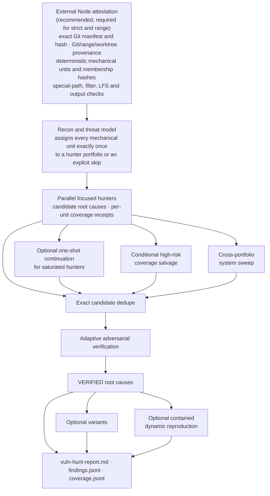
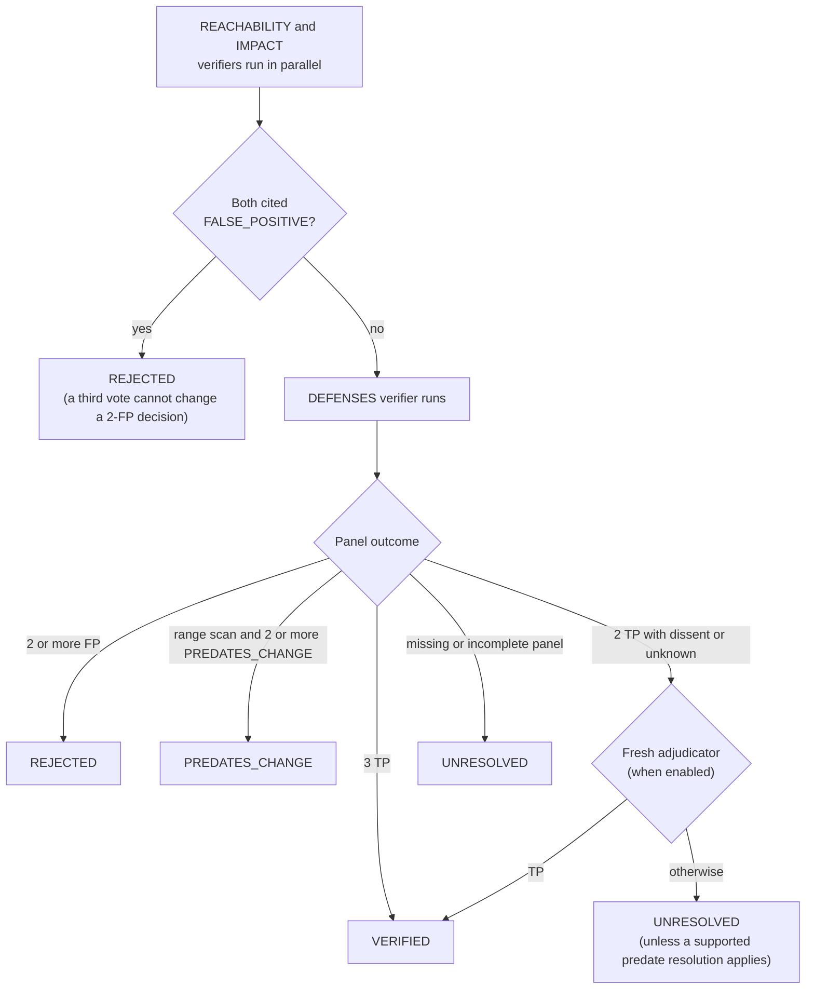

# vuln-hunt

`/vuln-hunt` is a compact Claude Code Dynamic Workflow for authorized source-code vulnerability research. Its objective is narrow: maximize **novel, independently verified, impactful root causes per total tokens / cost / wall time / custom orchestration**, while making coverage and provenance claims no stronger than the evidence supports.

The workflow deliberately does **not** embed a fixed vulnerability checklist. The research agents derive hypotheses from the target's code, trust boundaries, state, ownership, dangerous operations, and invariants.

Use it only on code you are authorized to test.

## Status

**Experimental.** It has been run on a small number of real open-source repositories, mostly Python, JavaScript/TypeScript, Go and Ruby. In one controlled check it found a known advisory, published after the model's training cutoff, in the vulnerable revision and did not report it in the fixed revision. That is far too few runs to estimate recall or false-positive rates, and it has not been compared head to head with other security scanners.

**Cost.** Whole-repository scans with Opus at high effort cost $11–26 as reported by Claude Code, on repositories with 0.2–0.7 MB of source; larger trees cost more. Nothing limits spending once a scan starts except Claude Code's `--max-budget-usd`, which ends the session, and with it the scan, when reached.

**Platform.** The installer, prerequisite checker and postflight checker are PowerShell scripts and have been used on Windows. `vuln-hunt-attest.js` also runs directly under Node on Linux and WSL.

What sets it apart is scan integrity rather than detection rate: the Git manifest and mechanical work units are computed outside the model, a freshness check refuses a run whose tree has changed since attestation, coverage is reported unit by unit with gaps labeled, and every finding needs independent verifier votes with citations.

## Architecture



## Requirements

- Claude Code **2.1.305 or newer**.
- Dynamic Workflows enabled in Claude Code.
- Git checkout for externally attested/strict provenance and all range reviews.
- Node.js with the standard APIs checked by `Test-VulnHuntPrereqs.ps1` / `vuln-hunt-attest.js --self-test`.
- A strong session model selected with `/model`; portable defaults inherit that model for security-critical reasoning.

Run prerequisite checks from a clean target repository root:

```powershell
& "$HOME\.claude\vuln-hunt\Test-VulnHuntPrereqs.ps1"
```

The prerequisite checker intentionally flags Git repository/config-selection environment variables even though the attestation helper itself strips them.

## Install

From a clone of this repository:

```powershell
.\Install-VulnHunt.ps1
```

It installs:

```text
~/.claude/workflows/vuln-hunt.js
~/.claude/vuln-hunt/vuln-hunt-attest.js
~/.claude/vuln-hunt/Get-VulnHuntAttestation.ps1
~/.claude/vuln-hunt/Compare-VulnHuntPostflight.ps1
~/.claude/vuln-hunt/Test-VulnHuntPrereqs.ps1
~/.claude/vuln-hunt/vuln-hunt-agents.json
~/.claude/vuln-hunt/vuln-hunt-launch.js
~/.claude/agents/vuln-hunt-researcher.md
~/.claude/agents/vuln-hunt-mechanic.md
~/.claude/agents/vuln-hunt-reporter.md
```

The installer backs up an existing personal workflow and warns about project-local workflow, command or skill collisions named `vuln-hunt`. Before each scan, run `Test-VulnHuntPrereqs.ps1`: current Claude Code workflow precedence allows a project `.claude/workflows/vuln-hunt.js` closer to the working directory to shadow the personal `~/.claude/workflows/vuln-hunt.js`. The prerequisite checker and strict attestation helper refuse known project-local `/vuln-hunt` command collisions rather than silently running an ambiguous command.

After installation, run **`/reload-skills`** in Claude Code (or start a fresh session), confirm Dynamic Workflows are enabled in `/config`, and choose the desired `/model`. Current workflow documentation explicitly says `/reload-skills` re-reads workflow directories after an edited/saved workflow; personal workflows live under `~/.claude/workflows/`.

## Worker agents and the launcher

Every stage runs as one of three worker agents defined in `vuln-hunt-agents.json`. Each worker starts without the user, project or local `CLAUDE.md` (`omitClaudeMd`):

| Worker | Tools | Stages |
|---|---|---|
| `vuln-hunt-researcher` | Read, Glob, Grep | recon, hunters, continuation, salvage, sweep, verifiers, adjudicator, variants |
| `vuln-hunt-mechanic` | Bash, PowerShell, Read, Glob, Grep | attestation freshness check, fallback model inventory |
| `vuln-hunt-reporter` | Read, Glob, Write, Bash, PowerShell | report |

Research workers therefore cannot run commands, write files, fetch URLs or call MCP tools, whatever a scanned repository's text asks for. Dynamic reproduction (`mode:"dynamic"`) keeps the default agent because it must execute code. If a worker is not available the workflow stops with an error naming it rather than falling back to the default agent.

The installer writes the workers to `~/.claude/agents/`, so `/vuln-hunt` works in an ordinary session. A project `.claude/agents/` file with a worker's `name` outranks those user-level copies. The attestation helper therefore refuses to run while any `.claude/agents/` directory from the working directory upward (other than `~/.claude/agents/`) defines a worker name. An unattested scan has no such check.

For strict runs, start Claude Code through the launcher from the repository root, then run `/vuln-hunt` inside that session:

```powershell
node "$HOME\.claude\vuln-hunt\vuln-hunt-launch.js"
```

The launcher passes the worker definitions with `--agents`. These session definitions outrank project and user agents, so the repository cannot replace a worker. It also passes `--setting-sources user --strict-mcp-config` with an empty MCP configuration, so project settings, project hooks, project and subdirectory `CLAUDE.md` files, and every MCP server are left out for all agents. It resolves `claude` outside the enclosing repository roots, and other arguments, such as `--model`, are passed through. `--restricted` is not used because it also stops user-level workflows, including the installed `/vuln-hunt`, from loading.

A subdirectory `CLAUDE.md` still loads into an `omitClaudeMd` worker that reads files in that directory, unless the session was started through the launcher. The prompts treat repository text as untrusted evidence either way.

A headless session (`-p`) stops waiting for background work ten minutes after its turn ends, which aborts any scan still running. The launcher sets `CLAUDE_CODE_PRINT_BG_WAIT_CEILING_MS=0` so the session waits for the workflow; set the variable yourself to keep a different limit. Started without the launcher, a headless scan needs the same setting, or a prompt that keeps the session's turn open until the workflow reports back.

## Recommended strict static run

Start Claude Code with `vuln-hunt-launch.js` (see above), and generate a **fresh** attestation from the repository root for every run:

```powershell
$att = & "$HOME\.claude\vuln-hunt\Get-VulnHuntAttestation.ps1"
$att | Set-Clipboard
```

WSL/Linux:

```bash
node ~/.claude/vuln-hunt/vuln-hunt-attest.js
```

Pass the returned JSON as `attestation` and use:

```json
{
  "strictProvenance": true,
  "attestation": { "...": "fresh helper output" },
  "hunters": 4,
  "candidateCap": 3,
  "salvageRisk": "high"
}
```

In this mode the workflow **does not call an inventory model**. It consumes the helper's exact manifest-derived mechanical units directly, then asks the recon model only to threat-model and group them into research portfolios.

### Range review

A range review always requires external attestation:

```powershell
$att = & "$HOME\.claude\vuln-hunt\Get-VulnHuntAttestation.ps1" -Range 'main...HEAD'
```

Use the same range in the workflow request. Range review requires a clean checkout whose `HEAD` exactly equals the resolved `rangeHead`.

The change reaches research agents from the attestation rather than from Git. Recon sees every changed file's hunk coordinates. Each hunter also sees the removed lines for changed files in its units, and each verifier sees the removed lines for the candidate's file. Added lines are read from the checked-out head.

Supported semantics:

```text
A..B     => tree A to tree B
A...B    => merge-base(A,B) to B
REF      => first parent to REF; empty tree to a root commit
```

## External attestation: what it actually proves

The helper derives from Git, outside any model. For strict reproducibility, the untracked-file boundary honors repository `.gitignore` files but deliberately does **not** honor user/global `core.excludesFile` or local `.git/info/exclude`, so machine-local ignore configuration cannot silently hide source from the manifest.

A fixed list of untracked OS, editor and Claude Code metadata is excluded instead: `.DS_Store`, `Thumbs.db`, `ehthumbs.db` and `desktop.ini` at any depth, and the top-level `.idea/`, `.vscode/` and `.claude/settings.local.json`. Claude Code hides `settings.local.json` only through the user's global Git ignore file, so without this list approving a permission prompt during a run would make the checkout look dirty and fail postflight. The exclusion applies to untracked files only; a committed `.vscode/tasks.json` stays in the manifest. The attestation records:

- canonical repository root
- current revision
- exact tracked + untracked-not-ignored-by-repository-`.gitignore` NUL-delimited manifest
- manifest object hash and file count
- root counts
- deterministic mechanical units
- per-unit membership hashes and full `unitsHash`
- tracked symlinks and submodules
- deleted tracked files
- sparse/shallow/partial state
- custom Git filter mapping hash
- grafts and object alternates
- case-collision state
- LFS pointer placeholders
- reserved output-path safety
- SHA-256 of the working-tree bytes of every manifest entry (`contentHash`), read directly rather than through Git filters
- range endpoints and changed-file NUL hash/count
- range evidence (`rangeFiles`): per changed file, its status, modes, rename source, binary/submodule flags, hunk coordinates and removed lines. Up to 256 files, 16 KiB of removed text per file and 256 KiB overall are kept, with truncation flags
- `stateHash` over all of the above, and the absolute `helperPath` and `nodePath` used by the freshness check

The unit algorithm uses bytewise UTF-8 ordering rather than locale-sensitive collation so the same valid Git pathname set is not intentionally partitioned differently merely because Windows and Linux have different locale behavior.

This is **not a signed attestation**. A user can edit JSON. It is an independently computed provenance record intended to be passed directly from the bundled helper, not a tamper-proof security token.

It also does not prove that a research agent truly read every member file. Coverage receipts remain evidence from the researcher; the workflow labels gaps instead of promoting them to complete coverage.

### Fallback without attestation

A whole-tree non-strict scan can still run without the helper. A Sonnet inventory agent then mechanically inventories and partitions the repository, and provenance is labeled:

```text
MODEL_REPORTED_PROVENANCE
```

That mode is deliberately weaker and should not be relied on for coverage claims. `strictProvenance:true` and all range reviews require external attestation.

## Coverage semantics

Possible unit states include:

```text
deep-reviewed
partial / not-reached
failed
coverage-conflict
receipt-missing
unaccounted-by-hunter
gap-reviewed
skipped
```

`deep-reviewed` requires a hunter to claim the unit was investigated *and* provide valid unit-local `file:line` receipts. This is stronger than treating a returned agent as evidence that its entire assignment was read, but it remains model evidence rather than cryptographic proof of file access.

A conditional salvage worker is used only for inadequately reached units at or above `salvageRisk` unless disabled.

The system sweep searches cross-portfolio boundaries but **never upgrades unit coverage**.

## Candidate identity and verification

Post-discovery candidates receive immutable `candidateId` values. Reproduction and verifier evidence attach by `candidateId`, not merely `rootKey`.

Pre-verification deduplication is intentionally conservative and exact over:

```text
rootKey + file + symbol + mechanism
```

There is no destructive semantic dedupe before verification.

`rootKey` grouping in the final report is a nondestructive reporting hint. Do **not** use `rootGroups.length` as a count of unique root causes; use an independent oracle.

A TRUE_POSITIVE vote must include complete structured source/path/sink/defense/gain reasoning and at least two valid in-inventory citations. False-positive and pre-existing-change verdicts require cited refutation. Malformed evidence is demoted to `UNKNOWN`.

Citations and coverage receipts are structured `{file, line, endLine?}` objects. Before validation, a file path written as an absolute path under the repository root, with a `./` prefix, with backslashes, or in Git Bash (`/d/...`) or WSL (`/mnt/d/...`) form is made repository-relative. On a case-insensitive checkout it is matched regardless of letter case. Candidate `file` fields are normalized the same way. A citation that still falls outside the inventory is not counted: votes keep it in `invalidCitations`, and coverage rows report the count of rejected receipts as `invalidReceipts`.

Verifier state machine:



The adaptive early stop is a cost optimization, not a claim that two votes are universally equivalent to three. Its effect on false rejection has not been measured.

## Recall / cost controls

### Hunter budget

```json
{"hunters":4}
```

Explicit range is 2-6. `"auto"` remains available, but no superiority claim is made for it.

`hunters` is a **maximum portfolio budget**, not a promise that recon will always dispatch exactly that many workers. The result records both budget and actual workers dispatched.

### Candidate cap

```json
{"candidateCap":3}
```

Allowed 1-6. A pass returning exactly the cap is recorded in `candidateSaturation` because additional leads may have been suppressed.

### Experimental saturated-hunter continuation

Off by default:

```json
{"saturationContinuation":true}
```

Only primary hunters that exactly hit `candidateCap` receive one second bounded pass. The pass is told to find *additional distinct roots* and makes no coverage claim. Compare this against simply raising `candidateCap` before considering it a default.

### Variants

Off by default:

```json
{"variants":true}
```

Use this when affected-site enumeration matters. Default-off better matches the workflow's optimization target of **new root causes** rather than more instances of already known roots.

## Model routing

Security-critical stages inherit your `/model` by default. Report generation defaults to Sonnet; fallback model inventory (only when no external attestation is supplied) defaults to Sonnet; the attestation freshness check (only when one is supplied) defaults to Sonnet at `low` effort and is routed with the `freshness` key.

Example:

```json
{
  "models": {
    "recon": "inherit",
    "hunt": "inherit",
    "continuation": "inherit",
    "salvage": "inherit",
    "sweep": "inherit",
    "verify": "inherit",
    "adjudicate": "inherit",
    "report": "sonnet"
  },
  "efforts": {
    "recon": "high",
    "hunt": "xhigh",
    "continuation": "xhigh",
    "verify": "xhigh",
    "adjudicate": "xhigh",
    "report": "medium"
  }
}
```

Optional restricted Mythos concentration where your account supports it:

```json
{
  "models": {
    "hunt": "claude-mythos-5-1",
    "verify": "claude-mythos-5-1",
    "adjudicate": "claude-mythos-5-1"
  }
}
```

Mythos is never a portable default. The workflow records **requested** routing. For measured runs, record the actual served model from Claude Code telemetry/workflow details because policy or availability can substitute models.

## Isolation policy

See `ISOLATION.md` for the complete policy.

Short version:

| Target / activity | Policy |
|---|---|
| Your own trusted repo, static scan | isolation optional; normal permission hygiene still applies |
| Unfamiliar/third-party repo, static scan | whole-session isolation strongly recommended |
| Dynamic reproduction, tests, builds, fuzzing, target execution | externally enforced whole-session/container/VM isolation required |

Claude Code's built-in Bash sandbox is useful defense in depth, but it is **not equivalent to whole-process isolation**. Current Claude Code documentation states that file tools, MCP servers, hooks and other processes can sit outside that command sandbox, and native Windows command sandboxing is not provided; WSL2 is the supported Linux sandbox path.

The current `sandbox-runtime` option wraps the full Claude Code process, but Anthropic documents it as a beta/research-preview isolation option. For genuinely hostile native-code execution, a disposable VM remains the conservative boundary.

The workflow does **not** pretend it can detect or enforce the external boundary from JavaScript. Dynamic mode requires an explicit assertion:

```json
{
  "mode":"dynamic",
  "containment":"vm",
  "network":false,
  "credentials":false
}
```

Accepted containment labels are:

```text
sandbox-runtime
container
vm
cloud-session
```

Those fields are assertions by the operator. They do not create the isolation themselves.

## Git and source-state fail-closed behavior

Strict/range mode intentionally refuses or degrades ambiguous states:

- partial/promisor clone: refused
- object alternates: refused for strict/range; helper refuses external alternates entirely
- sparse checkout: refused in strict/range
- LFS pointer placeholders: refused in strict mode
- custom clean/smudge/process filter: working-tree state becomes `UNKNOWN_FILTERS`; strict/range does not claim clean state
- legacy `info/grafts`: refused for range/strict history claims; non-strict current-tree fallback may continue with degraded history assumptions
- submodules: gitlink is a boundary; nested contents are not implicitly scanned
- tracked symlinks: not followed as repository coverage
- unsupported/non-UTF-8/control-character pathname, or a worktree symlink Git does not track as a symlink: every attested scan is refused, strict or not, because researchers could otherwise follow the link outside the repository
- case-colliding paths on case-insensitive checkout: refused
- `.vuln-hunt/**` tracked or link/reparse output traps: refused

The helper disables replacement refs, optional locks, fsmonitor use and pagers; refuses object alternates; detects content filters before working-tree comparison; avoids external diff/textconv; suppresses Git lazy fetch; strips repository-selection/config/trace Git environment variables; and resolves one absolute Git executable outside the target repository. "Outside" excludes every ancestor of the working directory that holds a `.git` entry, plus the main checkout named by a linked worktree's `.git` file, so a repository directory on `PATH` (direnv `PATH_add bin`, `node_modules/.bin`) is skipped even when a wrapper runs from a subdirectory or from a worktree nested in its main checkout (`.claude/worktrees/<name>`). If the only Git on `PATH` lives under such a root, for example a home directory that is itself a Git repository, the helper refuses and names the roots. The helper also refuses to run when it or its Node runtime lives under one of those roots, because the workflow re-executes both. The PowerShell wrappers and installer apply the same rule to `node`, `git` and `claude`.

## Static and dynamic evidence

Static is the default. Discovery and verification prompts prohibit target builds/tests/execution.

Evidence levels:

```text
STATICALLY_VERIFIED
EXECUTION_REPRODUCED
```

A failed dynamic reproducer does not automatically invalidate a statically proven logic flaw.

## Outputs

A successful report uses a fresh run-specific directory:

```text
.vuln-hunt/runs/<runId>/vuln-hunt-report.md
.vuln-hunt/runs/<runId>/findings.jsonl
.vuln-hunt/runs/<runId>/coverage.jsonl
```

Claude Code refuses subagent writes to Markdown files whose name starts with `REPORT`, `SUMMARY`, `FINDINGS` or `ANALYSIS`, so the human-readable report is `vuln-hunt-report.md`.

`.vuln-hunt/.gitignore` is maintained as exactly:

```text
*
```

The output namespace is reserved. Tracked output files, symlinks/junctions/reparse traps, pre-existing run directories, or unsafe targets cause the reporter to refuse rather than overwrite.

Only VERIFIED findings enter `findings.jsonl`. Each line is one JSON object with at least `candidateId`, `severity` (`critical`, `high`, `medium` or `low`) and `evidence` (`STATICALLY_VERIFIED` or `EXECUTION_REPRODUCED`). Unresolved/rejected candidates remain in the structured workflow result for auditability.

## Postflight check

External attestation is a point-in-time statement. Before recon, one low-effort agent runs the attested helper with the attested Node (`helperPath`, `nodePath`) as `--fingerprint <runId>` and returns its one-line output verbatim. The helper recomputes the full attestation and prints its `stateHash`, a SHA-256 over every repository-state field, including `contentHash`, which hashes the working-tree bytes of every manifest entry. The workflow refuses the run unless root, `HEAD`, worktree state, manifest hash, content hash and state hash all match, and `.vuln-hunt/runs/<runId>` is still absent. A helper error or output that does not parse also refuses the run. An attestation left on the clipboard across a `git pull`, branch switch, edit (including edits to already-dirty files) or earlier run is therefore not reused. The model only transports the line (`liveFreshness:helper-fingerprint` in `attestationChecks`), and neither the check nor the attestation can stop a concurrent writer from changing the tree during the run.

For measured trials, save the fresh attestation outside the repository and compare after the run:

```powershell
$beforeFile = Join-Path $env:TEMP ("vuln-hunt-before-" + [guid]::NewGuid() + ".json")
$att | Set-Content -LiteralPath $beforeFile -Encoding utf8
# run /vuln-hunt
& "$HOME\.claude\vuln-hunt\Compare-VulnHuntPostflight.ps1" -BeforeFile $beforeFile
```

For range scans pass the identical `-Range` value to the postflight checker. A mismatch means the tree changed during the run. The checker exits with a separate error when the helper itself fails, so a helper failure is not reported as provenance drift. The helper accepts a UTF-8 BOM in the saved file and writes ASCII-only JSON, escaping non-ASCII path characters, so the console code page cannot change it. The PowerShell checker parses case-sensitively under Windows PowerShell 5.1 and PowerShell 7.3+, and refuses PowerShell 6.0–7.2, where `ConvertFrom-Json -AsHashtable` merges keys that differ only by case.

Disposable pinned clones/worktrees with no concurrent writers remain the recommended setup.

## Local regression suite

From a clone of this repository:

```powershell
node .\tests\run.js
```

or:

```bash
node tests/run.js
```

The suite covers helper/runtime capabilities, repository-local executable poisoning (including from a worktree nested in its main checkout, and a helper copied into the repository), Git environment poisoning, dirty-content binding through `--compare` and `--fingerprint`, range evidence hunks, structured citation normalization, range evidence routing to hunters and verifiers, fingerprint freshness failures, worker-agent routing and missing-worker refusal, project agents shadowing a worker, worker definitions kept in sync, launcher arguments, installer-written user agents (Windows only), `SHA256SUMS.txt` against the shipped bytes (`.gitattributes` keeps every checkout LF, so `sha256sum -c SHA256SUMS.txt` also works), SHA-256 Git repositories, linked worktrees, object alternates, executable Git filters, filter mapping hashes, LFS accounting, deterministic unitization, project command-shadow refusal, output contamination/path traps, postflight drift, workflow parsing, strict provenance rejection paths, external-inventory bypass, stale-attestation refusal, unsupported-path refusal, untracked local-metadata exclusion, oversized-directory and single-child-chain unit splitting, BOM-prefixed and non-ASCII postflight input, case-only root keys in the PowerShell postflight checker (Windows only), adaptive verifier behavior, variants default-off, saturation continuation, dynamic containment semantics, and empty-target handling.

## What remains intentionally unproven

vuln-hunt does **not** establish that:

- a model literally read every file represented by a reached unit
- `rootKey` perfectly identifies semantic root-cause equivalence
- requested model equals served model
- a static proof is dynamically reproducible
- a `containment` string means the environment is actually isolated
- no source byte changed-and-returned-to-the-same-state between pre/post checks
- a particular hunter count, candidate cap, verifier mix, continuation policy or model allocation is optimal

Those are measurement questions, not claims hidden by the workflow.

## What is deliberately not included

No Agent Teams, database, RAG/MCP orchestration, Python scheduler, custom retry framework, patch engine, fixed language-specific vulnerability matrix, mandatory Mythos, persistent verifier memory, or SARIF subsystem.

## Security

Report vulnerabilities in vuln-hunt itself through private vulnerability reporting; see [SECURITY.md](SECURITY.md).

## License

[MIT](LICENSE)
